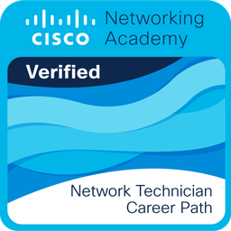
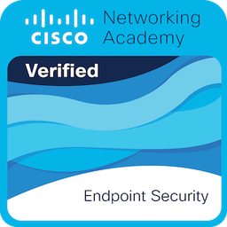

### Sobre mim

Entusiasta de cibersegurança, formado em Análise e Desenvolvimento de Sistemas, com anos de experiência em infraestrutura e redes.
Hoje desenvolvo sistemas para empresas e cuido dos servidores onde eles rodam.

- **Infra e redes:** Linux, Windows/AD, MikroTik, Docker, monitoramento com Zabbix
- **Segurança:** controle de acesso, criptografia, auditoria e LGPD
- **Desenvolvimento:** Python, Django, PostgreSQL e Rust

### Stack

  

### Certificados

<table>
  <tr>
    <td align="center" width="140"> <b>Network Technician Career Path</b> Cisco · 2025</td>
    <td align="center" width="140"> <b>Endpoint Security</b> Cisco · 2025</td>
    <td align="center" width="140"> <b>Formação Redes de Computadores</b> Alura · 2025</td>
  </tr>
  <tr>
    <td align="center" width="140"> <b>Backend Developer (160h)</b> Descomplica · 2024</td>
    <td align="center" width="140"> <b>Advanced Tester (160h)</b> Descomplica · 2025</td>
    <td align="center" width="140"> <b>Imersão Dev Agentes de IA</b> Alura + Google · 2025</td>
  </tr>
</table>

### Projetos

| Projeto | O que faz | Stack |
|---|---|---|
| [**MonitorBT**](https://github.com/renato-sant/monitor-bluetooth) | Mostra na bandeja do Windows a bateria de cada dispositivo Bluetooth, com aviso de bateria baixa | Rust |
| **ERP de manutenção** *(privado)* | Clientes, equipamentos, agenda de técnicos, financeiro e estoque, com lembretes automáticos pelo WhatsApp | Django · PostgreSQL · Docker |
| **Inventário de T.I.** *(privado)* | Unidades e ativos, monitoramento via Zabbix com alertas no Telegram e cofre de senhas criptografado (AES-256-GCM) | Django · PostgreSQL · Docker |

### Atividade

<picture>
  <source media="(prefers-color-scheme: dark)" srcset="https://raw.githubusercontent.com/renato-sant/renato-sant/output/cobrinha-escuro.svg" />
  <source media="(prefers-color-scheme: light)" srcset="https://raw.githubusercontent.com/renato-sant/renato-sant/output/cobrinha-claro.svg" />
  
</picture>

