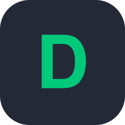

### Oi, eu sou o Renato

Desenvolvo sistemas de gestão para empresas reais e também cuido da infraestrutura onde eles rodam:
do código ao servidor, da rede ao backup.

- **ERPs e sistemas web** com Python, Django e PostgreSQL, feitos primeiro para o celular (PWA)
- **Ferramentas para Windows** em Rust
- **Infra e sysadmin:** Linux, Windows/AD, redes, MikroTik, monitoramento com Zabbix
- **Segurança e LGPD** desde o começo do projeto: criptografia, auditoria, controle de acesso
- Uso agentes de IA no dia a dia para planejar, revisar e testar

### Stack

  

### Certificados

<table>
  <tr>
    <td align="center" width="140"> <b>Network Technician Career Path</b> Cisco · 2025</td>
    <td align="center" width="140"> <b>Endpoint Security</b> Cisco · 2025</td>
    <td align="center" width="140"> <b>Formação Redes de Computadores</b> Alura · 2025</td>
  </tr>
  <tr>
    <td align="center" width="140"> <b>Backend Developer (160h)</b> Descomplica · 2024</td>
    <td align="center" width="140"> <b>Advanced Tester (160h)</b> Descomplica · 2025</td>
    <td align="center" width="140"> <b>Imersão Dev Agentes de IA</b> Alura + Google · 2025</td>
  </tr>
</table>

### Projetos

| Projeto | O que faz | Stack |
|---|---|---|
| [**MonitorBT**](https://github.com/renato-sant/monitor-bluetooth) | Mostra na bandeja do Windows a bateria de cada dispositivo Bluetooth, com aviso de bateria baixa | Rust |
| **ERP de manutenção** *(privado)* | Clientes, equipamentos, agenda de técnicos, financeiro e estoque, com lembretes automáticos pelo WhatsApp | Django · PostgreSQL · Docker |
| **Inventário de T.I.** *(privado)* | Unidades e ativos, monitoramento via Zabbix com alertas no Telegram e cofre de senhas criptografado (AES-256-GCM) | Django · PostgreSQL · Docker |

### Atividade

